<div align="center">

# RouteRate – Voice Rate Deck Engine

**Turns messy wholesale-voice vendor rate decks into clean, validated rates, Least Cost Routing and customer rate sheets.**


[Features](#key-features) · [How it works](#how-it-works) · [Windows setup](#quick-start-windows-one-click) · [Demo logins](#demo-logins) · [Screenshots](#screenshots) · [Case study](#case-study) · [Resume bullets](#resume-bullet-points)

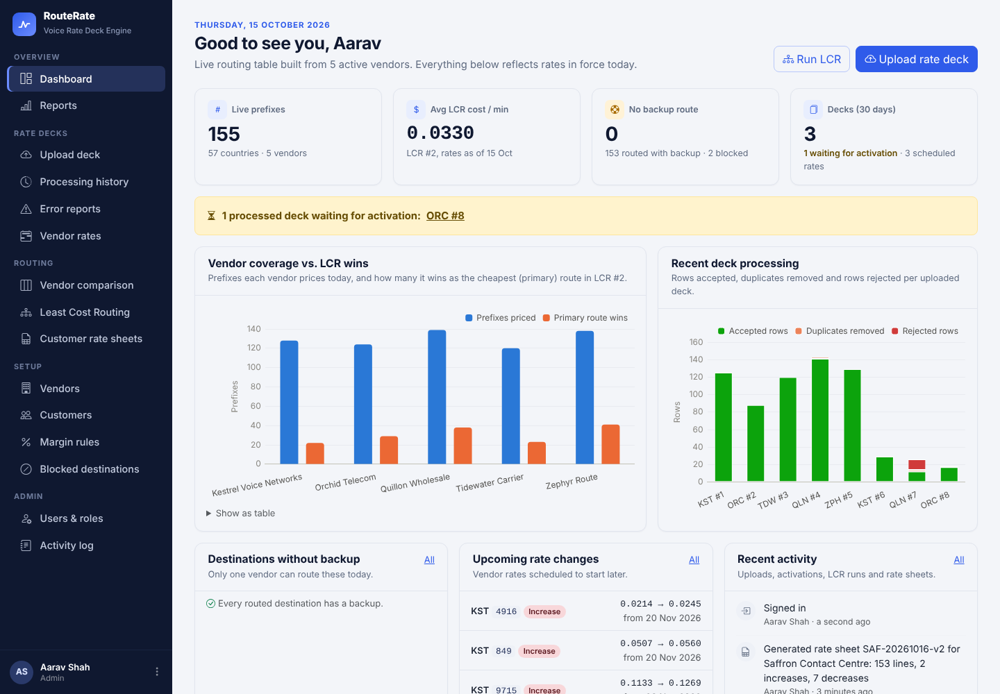

</div>

> All vendors, customers, people and prices in this project are **fictional**. Country dial codes are the real ITU codes.

---

## About

In wholesale voice (VoIP) telecom, every carrier you buy from sends a **rate deck**: a spreadsheet listing the price per minute to call each destination prefix (for example `447` = UK mobile). Each vendor uses its own layout, delimiters, date formats and naming, and the files arrive often, with price increases, decreases, new prefixes and mistakes.

**RouteRate** is a web application that:

1. Takes those vendor files (CSV or Excel) in **any layout**, with a **flexible column mapping**
2. **Normalizes and validates** every row (prefixes, rates, dates, countries, duplicates) and produces an **error report**
3. Manages **effective dates**, so rate history is never lost and future price changes are scheduled
4. Compares vendors **prefix by prefix** and calculates **Least Cost Routing** with **primary and backup** routes
5. Applies **margin rules** and **blocked destinations** to generate versioned **customer rate sheets**
6. Shows **dashboards and reports**, with **CSV/Excel export** everywhere

## Why I built this

This project is based on my professional experience with **voice rate generation** in the wholesale telecom industry. The real work involved receiving vendor rate decks in many different formats, cleaning them, comparing vendors, picking the cheapest routes and producing customer price lists, often in spreadsheets, where one wrong decimal or a duplicated prefix costs real money.

The original systems and data are private, so I rebuilt the core ideas **from scratch** as an open-source project with **fictional data**. It shows how I handle messy real-world files, design a relational database for time-based pricing, and put business rules (routing, margins, notice periods) into tested code.

---

## Key features

### Accounts and roles
- Login with Django authentication, password change, session handling
- Three roles enforced **on the server** for every page and action:

| Role | Can do |
|---|---|
| **Admin** | Everything, plus user management, deleting vendors and LCR runs, activity log |
| **Rate Analyst** | Upload, map, validate and activate decks; manage vendors, customers, margins and blocks; run LCR; generate rate sheets |
| **Viewer** | Read-only dashboards, reports, comparisons and rate sheets, including downloads |

### Rate deck processing
- **Vendor management** with priority (used to break price ties) and default billing increment
- **CSV and Excel upload** (`.csv`, `.xlsx`) with drag and drop, size and type checks
- **Automatic header detection** (skips title rows) and **delimiter detection** (`,` `;` tab `|`)
- **Flexible column mapping** with suggestions from 60+ column-name aliases, live preview highlighting in vanilla JS, and a **saved mapping per vendor** for the next upload
- **Data normalization**
  - Prefixes: `+44 7`, `0044 7` → `447`; lists `44, 447`; ranges `4470-4479`
  - Rates: `$0.0123`, `0,0123`, `0.0123 USD` → `0.012300`
  - Dates: ISO, `dd/mm/yyyy` or `mm/dd/yyyy`, `15-Oct-2026`, Excel date cells and serial numbers, "Immediate"
  - Billing increments: `60-60`, `1/1`, `30` → `60/60`, `1/1`, `30/30`; ALL-CAPS names tidied
- **Country and prefix validation**: every prefix must start with a real country dial code (longest match, so `1876` = Jamaica, not USA); destination names are checked against the prefix's country
- **Duplicate prefix handling** with a chosen policy: keep lowest, keep highest, keep last, or reject all
- **Error reports**: rejected rows with row number, field, value and reason; warnings (kept) and duplicates; per deck or across all decks; exportable
- **Change detection** against current rates: New, Increase, Decrease, Unchanged, Removed
- **Increase notice check**: warns when a vendor increase has less than 7 days notice
- **Processing history** with statistics, processing log and the original file

### Effective-date management
- Rates are stored as periods: `effective_from` (inclusive) to `effective_to` (exclusive)
- Activating a deck **closes** old periods instead of deleting them, so you can ask "what was the price on any date?"
- Future-dated rates are **scheduled** and take effect automatically on their date
- **Full A-Z deck** closes prefixes missing from the file; **partial update** changes only the listed prefixes
- A **rate browser** shows rates in force on any date, scheduled changes, and full history

### Routing and pricing
- **Prefix-based vendor comparison** matrix with the cheapest and second-cheapest highlighted
- **Longest-prefix matching**: a vendor that quotes only `447` still has a price for `4475` (shown as *via 447*), but a fallback **never crosses a country code** (a USA `1` price is not a price for Jamaica `1876`)
- **Least Cost Routing** saved as runs: primary, backup and 3rd route per prefix, "no backup" alerts, backup cost gap
- **Blocked destinations**: block a prefix for everyone, or skip one vendor for a prefix (for example poor call quality)
- **Margin rules**: percentage or fixed per-minute markup, minimum margin, by customer / country / prefix; the most specific rule wins and prices are rounded **up**
- **Customer rate sheets**: versioned (`HRB-20261016-v2`), compared with the previous sheet, removed prefixes listed, and **increases automatically moved out to respect the customer's notice period**
- **Customer Excel** (no cost data) and **internal Excel** (cost, margin, vendor, rule)

### Reports and exports
- Dashboard: KPI cards, vendor coverage vs LCR wins, deck processing outcomes, destinations without backup, upcoming rate changes, recent activity
- Reports (Chart.js + Pandas): vendor competitiveness, average cost by region, customer margins, vendor rate changes, LCR cost by country
- **CSV and Excel export** of vendor rates, normalized decks, error reports, comparisons, LCR runs, rate sheets and reports; Excel files have styled headers, frozen panes, filters, number formats and colour-coded changes
- Responsive layout (Bootstrap) that works on a phone

---

## Tech stack

| Layer | Technology |
|---|---|
| Backend | **Python 3.12**, **Django 5.2** (function-based views, forms, ORM, migrations, auth) |
| Database | **MySQL 8** via PyMySQL (pure Python, no compiler needed on Windows) |
| Data processing | **Pandas** (frames, group-by for duplicates and reports), **OpenPyXL** (read/write Excel) |
| Frontend | **Django templates, HTML5, CSS3, vanilla JavaScript**, **Bootstrap 5.3**, Bootstrap Icons, **Chart.js 4** (served locally, works offline) |
| Testing | Django test framework, 36 tests (unit, workflow and permission) |
| Tooling | Windows one-click `.bat` scripts, macOS/Linux `.sh` scripts |

---

## How it works

### Processing pipeline

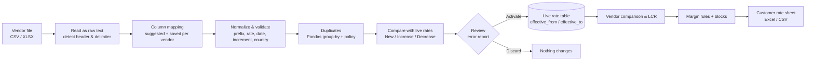

### Effective dates in one example

From the demo data: Kestrel's rate for `4916` (Germany mobile).

| Event | Rate periods stored for KST `4916` |
|---|---|
| Full deck effective 1 Aug 2026: 0.0214 | `0.0214  1 Aug → open` |
| Partial update with an increase effective 20 Nov 2026: 0.0245 | `0.0214  1 Aug → 20 Nov` and `0.0245  20 Nov → open` (scheduled) |

Nothing is deleted. Today's LCR uses 0.0214, an LCR run "as of 20 Nov" uses 0.0245, and the old rate stays in the history.

### Least Cost Routing in one example

From the demo data (rates per minute, cheapest in bold):

| Prefix | KST | ORC | TDW | ZPH | Primary | Backup |
|---|---|---|---|---|---|---|
| `447` UK Mobile | 0.0101 | 0.0107 | 0.0113 | **0.0096** | ZPH | KST |
| `4475` UK Mobile | 0.0101 *via 447* | 0.0107 | 0.0113 *via 447* | **0.0092** | ZPH | KST |
| `1876` Jamaica | **0.1319** | — | 0.1492 | 0.1502 | KST | TDW |

KST has no exact price for `4475`, so its `447` price applies (*via 447*). ORC sells USA & Canada (`1`) but not Jamaica, so it gets no price for `1876`: a fallback never crosses into another country code.

### Database design

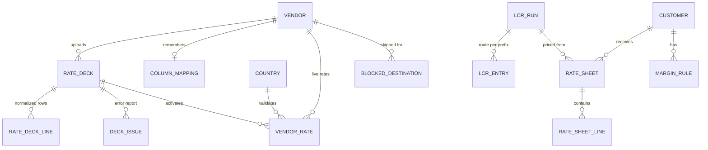

25 tables in total. Full DDL: [`database/schema.sql`](database/schema.sql). Indexes cover vendor + prefix lookups, effective-date ranges, deck status and LCR filters.

---

## Folder structure

```
routerate/
├── apps/
│   ├── accounts/            User model with roles, login, user management, permission decorators
│   ├── core/                Countries, dashboard, reports, activity log, exports, seed command
│   │   ├── data/countries.py        75 countries + ITU dial codes
│   │   ├── exports.py               CSV / styled Excel export helpers (Pandas + OpenPyXL)
│   │   └── management/commands/seed_demo.py
│   ├── vendors/             Vendor management
│   ├── ratedecks/           Upload, mapping, processing, activation, error reports, rate browser
│   │   └── services/
│   │       ├── reader.py        CSV/Excel reading, delimiter & header detection
│   │       ├── mapping.py       Column aliases and mapping suggestions
│   │       ├── normalize.py     Prefix / rate / date / increment parsing rules
│   │       ├── processor.py     Validation, duplicates, change detection, error report
│   │       └── activation.py    Effective-date management
│   └── routing/             Customers, margins, blocks, LCR, rate sheets
│       └── services/
│           ├── lcr.py           Prefix comparison and Least Cost Routing
│           ├── pricing.py       Margin rule resolution and sell-rate rounding
│           └── ratesheet.py     Versioned customer rate sheets with notice periods
├── config/                  Django settings (reads .env), URLs
├── templates/               Django templates (Bootstrap 5)
├── static/
│   ├── css/app.css          Custom theme
│   ├── js/                  Vanilla JS: mapping preview, upload drag & drop, charts
│   └── vendor/              Bootstrap, Bootstrap Icons, Chart.js (local copies)
├── sample_data/             Fictional vendor rate decks in 5 different layouts
├── database/                schema.sql and create_database.sql
├── scripts/                 configure.py (MySQL setup), generate_sample_data.py
├── docs/screenshots/
├── setup.bat  start.bat  reset_demo.bat  run_tests.bat     Windows one-click scripts
├── setup.sh   start.sh                                      macOS / Linux
└── requirements.txt
```

---

## Quick start (Windows, one click)

**You need**
1. **Python 3.12 or newer** from [python.org](https://www.python.org/downloads/). During install, tick **"Add python.exe to PATH"**.
2. **MySQL 8** from [dev.mysql.com](https://dev.mysql.com/downloads/installer/) (MySQL Installer, "Server only" is enough). Remember the **root password** you choose. Make sure the **MySQL80** service is running.

**Then**
1. Download or clone this repository and open the folder.
2. Double-click **`setup.bat`**. It will:
   - find Python and create a virtual environment (`.venv`)
   - install the packages from `requirements.txt`
   - ask for your MySQL username and password, test the connection and create the `routerate` database
   - create the tables (Django migrations) and load the demo data
3. Double-click **`start.bat`**. Your browser opens **http://127.0.0.1:8000** after a few seconds.
4. Log in with a [demo account](#demo-logins).

| Script | What it does |
|---|---|
| `setup.bat` | One-time setup. Safe to run again. It never deletes your data. |
| `start.bat` | Starts the app. Keep the window open, press Ctrl+C to stop. |
| `reset_demo.bat` | Deletes all data and reloads the demo (asks you to type YES). |
| `run_tests.bat` | Runs the automated test suite. |

To change the MySQL login later: `.venv\Scripts\python scripts\configure.py --reconfigure`

### macOS / Linux

```bash
chmod +x setup.sh start.sh
./setup.sh      # same steps as setup.bat
./start.sh      # http://127.0.0.1:8000
```

### Manual setup

```bash
python -m venv .venv
.venv\Scripts\activate            # macOS/Linux: source .venv/bin/activate
pip install -r requirements.txt
copy .env.example .env            # macOS/Linux: cp .env.example .env  -> then edit the DB_* values
python scripts/configure.py       # or create the database yourself, see below
python manage.py migrate
python manage.py seed_demo
python manage.py runserver
```

### MySQL setup by hand (optional)

`setup.bat` creates the database for you. To do it yourself, run [`database/create_database.sql`](database/create_database.sql) in MySQL Workbench (it also creates a dedicated `routerate` user), then put that login in `.env`. The full table structure is in [`database/schema.sql`](database/schema.sql) for reference; the normal way to create tables is `python manage.py migrate`.

### Troubleshooting

| Message | Fix |
|---|---|
| `Python 3.12 or newer was not found` | Install Python and tick "Add python.exe to PATH", then open a new window |
| `Could not reach MySQL` | Start the MySQL service: Windows key → "Services" → **MySQL80** → Start |
| `Access denied` | Wrong MySQL password. Run `setup.bat` again, it will ask again |
| `That port is already in use` | Another app uses port 8000. Edit `PORT` in `start.bat` |
| Pages have no styling | Make sure `DJANGO_DEBUG=True` in `.env` for local use |

---

## Demo logins

Password for every account: **`RouteRate@123`**

| Username | Role | Try this |
|---|---|---|
| `admin` | Admin | Users & roles, activity log, everything else |
| `analyst` | Rate Analyst | Upload a deck, activate the waiting Orchid deck, run LCR, build a rate sheet |
| `viewer` | Viewer | Browse and download; upload and edit pages return "access denied" |

### What the demo data contains
- 5 fictional vendors whose decks use **5 different file layouts** (see [`sample_data/README.md`](sample_data/README.md))
- About 650 live vendor rates across 57 countries, built by running the sample files through the **real** pipeline
- A Kestrel partial update with increases, decreases, new prefixes and **3 scheduled future increases**
- A messy deck with **12 rejected rows** (discarded) so the error report has content
- An Orchid price update **waiting for activation**
- 3 customers, 7 margin rules, 4 blocked destinations, 2 LCR runs and 5 rate sheets (version 1 and 2)

### Try it yourself
1. Log in as `analyst` and go to **Upload deck**.
2. Upload `sample_data/try_it_yourself/messy_vendor_deck.csv`. The header is found on row 3 and the columns map automatically.
3. Click **Process & validate** and open the **Errors** tab, then download the error report.
4. Open **Vendor comparison**, filter prefix `44`, then **Least Cost Routing** → Calculate, then **Generate rate sheet**.

---

## Screenshots

| | |
|---|---|
| **Dashboard**<br> | **Column mapping** with live preview<br>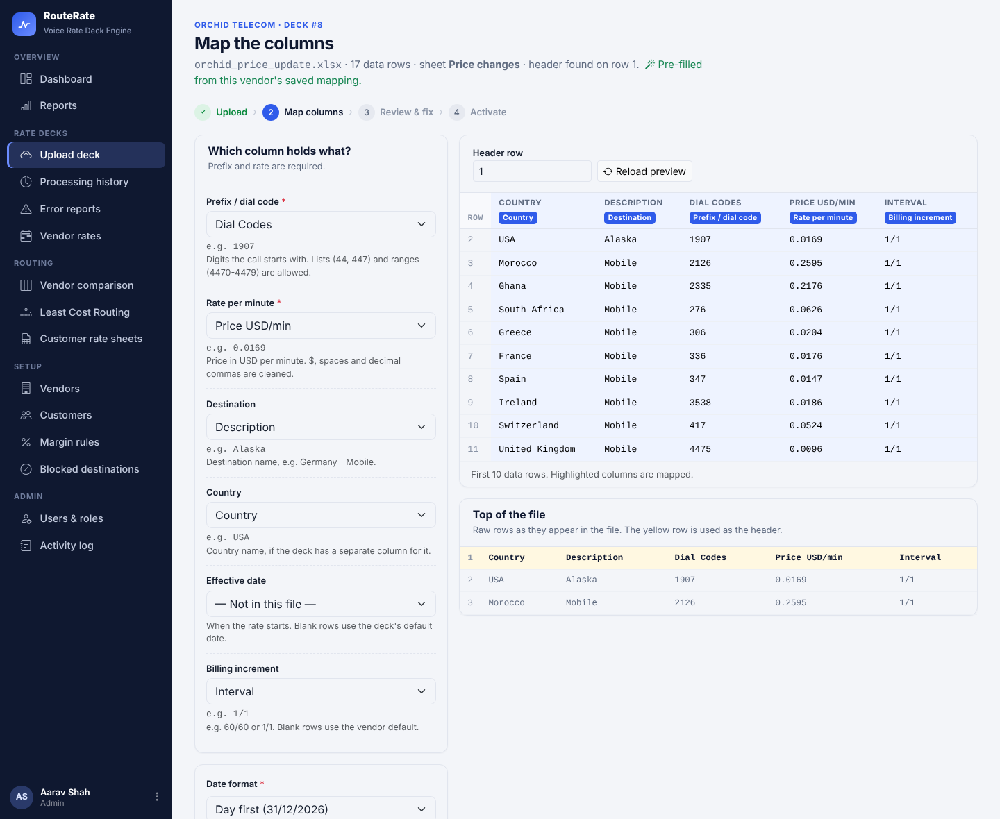 |
| **Deck review** with change detection<br>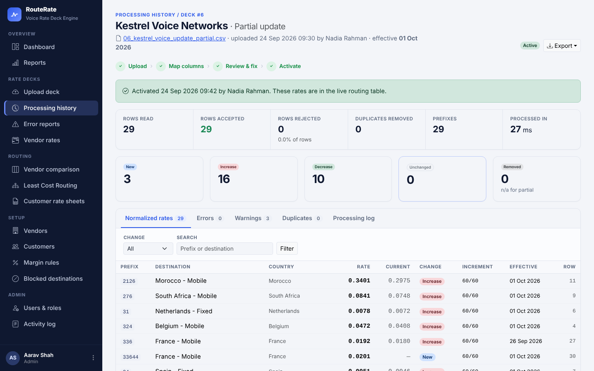 | **Error report**<br>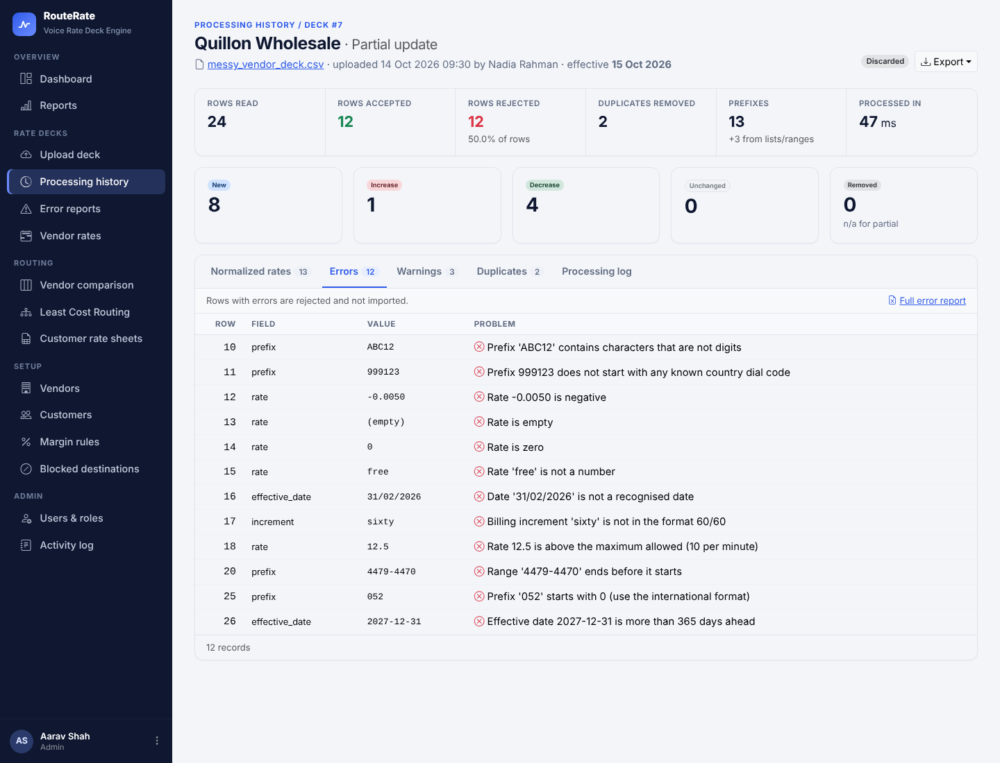 |
| **Vendor comparison** (cheapest highlighted, "via" fallbacks)<br>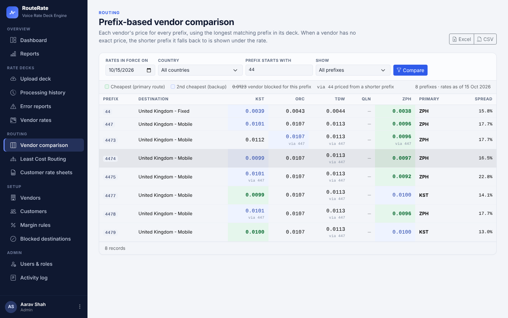 | **Least Cost Routing**<br>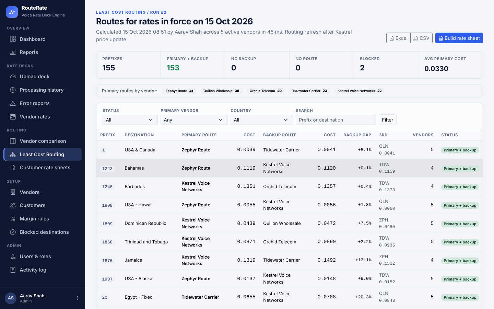 |
| **Customer rate sheet** (notice period applied)<br>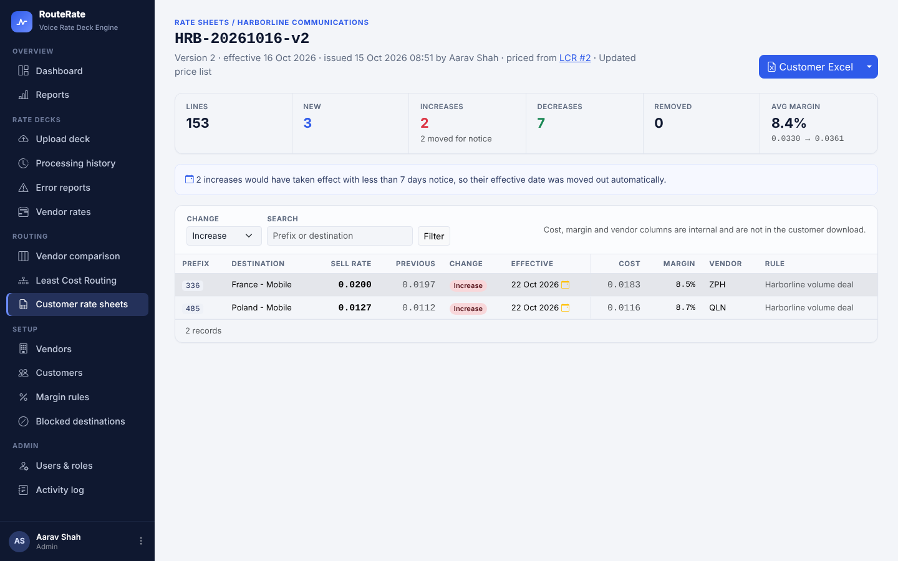 | **Reports**<br>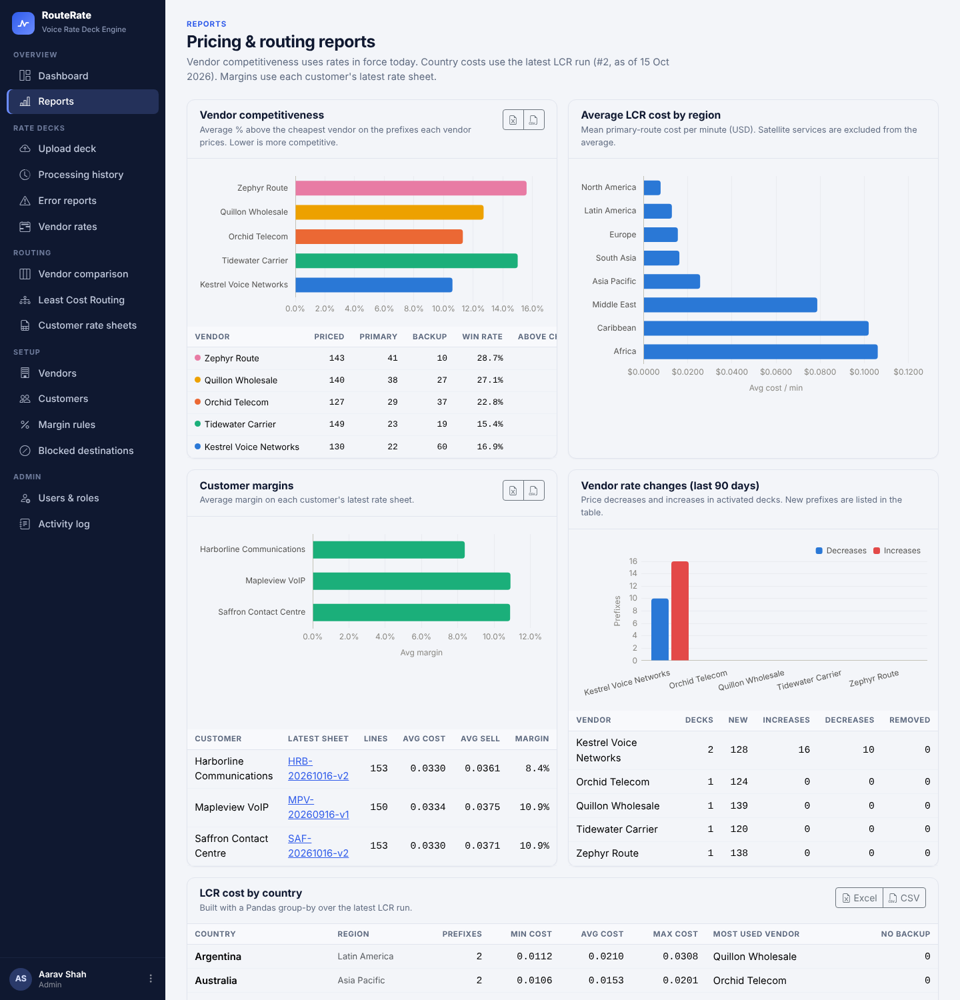 |
| **Rate history** (effective dates)<br>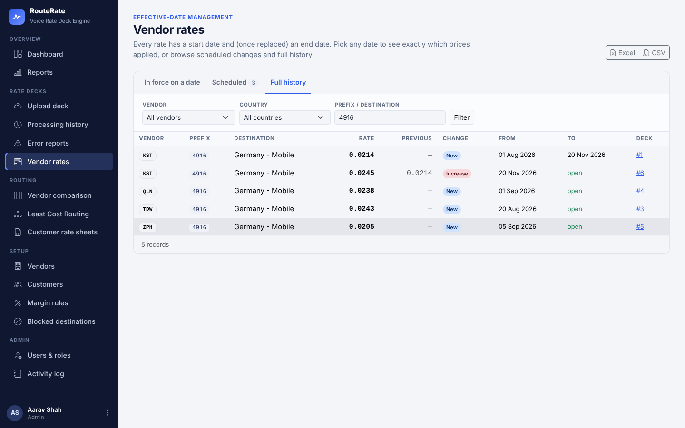 | **Upload**<br>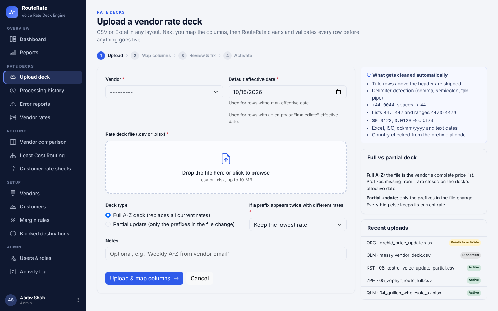 |
| **Login**<br>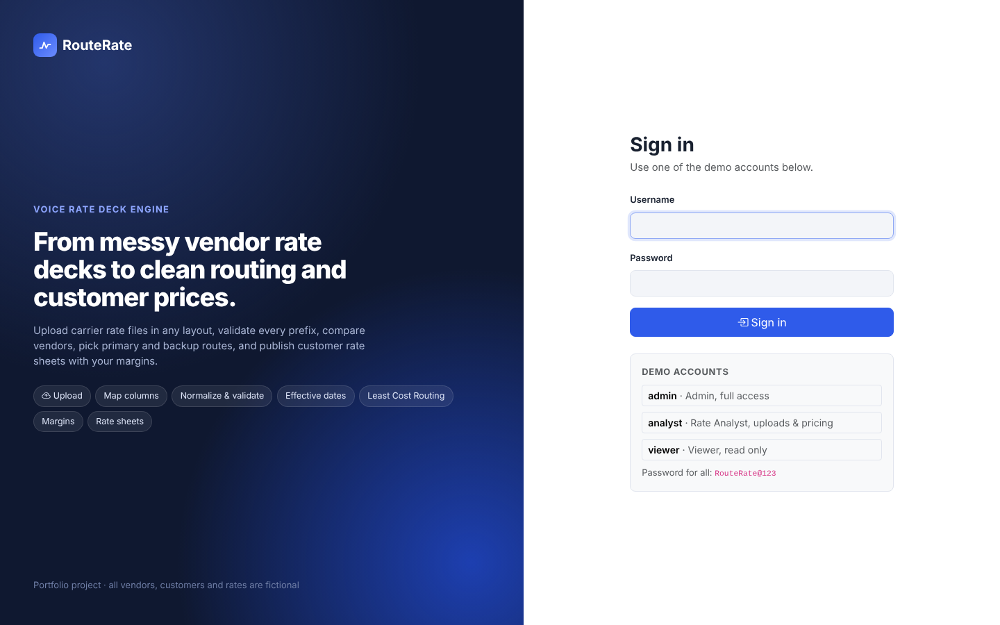 | **Mobile**<br>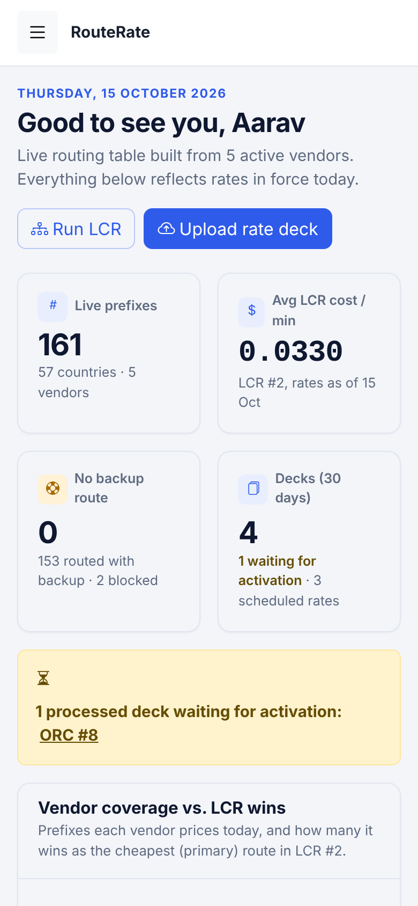 |

---

## Tests

```bash
python manage.py test          # Windows: run_tests.bat
```

36 tests run against MySQL (Django creates and drops a temporary `test_routerate` database):

- **Normalization**: prefix formats, lists and ranges; rate formats; date formats including Excel serials; increments
- **Mapping and reading**: alias matching, saved mappings, semicolon CSV, title rows, numeric Excel prefixes
- **Processing**: rejected rows with reasons, all four duplicate policies, range expansion
- **Effective dates**: closing periods, full-deck removals, scheduled rates, same-day corrections, notice warnings
- **Routing**: cheapest vendor, priority tie-break, longest-prefix fallback, **no cross-country fallback**, blocks
- **Pricing and rate sheets**: rule priority, minimum margin, round-up, versions, change detection, notice period
- **Roles and workflow**: viewer/analyst/admin permissions, and a full upload → map → activate → LCR → rate sheet → Excel run through the web UI

---

## Case study

### Problem
Pricing teams in wholesale voice receive rate decks from many carriers, each in a different format. Doing the work in spreadsheets is slow and risky:

- Every file needs manual cleanup (title rows, `+44` vs `0044`, decimal commas, mixed date formats)
- Typos, duplicate prefixes and missing prices are easy to miss, and one bad rate can cause losses on every call
- Old prices get overwritten, so nobody can answer "what did we pay on the 3rd?"
- Picking the cheapest vendor per prefix, adding margins and telling customers about increases in time is repetitive and error-prone

### Solution
A web application that makes every step repeatable and checked:

- A **mapping step** that handles any file layout and remembers it per vendor
- A **validation pipeline** that cleans what it safely can, rejects what it cannot, and explains every decision in an exportable error report
- **Time-based storage** of rates, so history is kept and future changes are scheduled
- An **LCR engine** with primary and backup routes, blocks and correct prefix matching
- **Rule-based pricing** that produces versioned customer rate sheets and respects notice periods
- **Roles**, so analysts can make changes and others can only view

### Results (on the demo data)
- 8 vendor files in 5 different layouts processed with **no manual editing**; all columns mapped automatically
- A deck of ~140 rows is validated in under **100 ms**, and LCR for all 155 prefixes across 5 vendors runs in under **100 ms**
- 12 different kinds of data errors caught and reported with row numbers
- Every price change kept as history, with scheduled future rates

### What I learned
- **Read everything as text first.** Letting Pandas guess types turned `447` into `447.0` and broke dates. Reading raw text and normalizing it explicitly made the pipeline predictable.
- **Never trust date order.** `05/10/2026` is May or October depending on the vendor, and a generic parser read ISO dates wrongly when told "day first". ISO is parsed separately and the day/month order is a mapping option.
- **Store time periods, not just prices.** Using `effective_from` / `effective_to` instead of overwriting rows made history, scheduled changes and "LCR on any date" simple queries.
- **Test the business rules, not just the code.** Looking at the comparison screen showed the engine pricing Jamaica (`1876`) with a vendor's USA (`1`) rate because of longest-prefix matching. That would route calls at a huge loss. I fixed it so fallbacks never cross a country code, and added a test for it.
- **Keep business logic out of views.** Reading, normalizing, activation, LCR and pricing live in small service modules, which made them easy to test without a browser.
- **Make setup boring.** A one-click Windows setup with clear error messages matters as much as the features for someone trying the project.

---

## Resume bullet points

**RouteRate – Voice Rate Deck Engine** | Python, Django, MySQL, Pandas, OpenPyXL, JavaScript, Bootstrap, Chart.js

- Built a full-stack web application in Python/Django and MySQL that processes vendor voice rate decks (CSV/Excel), calculates Least Cost Routing and generates customer rate sheets
- Developed a data pipeline with Pandas and OpenPyXL that detects headers and delimiters, maps columns flexibly with per-vendor saved mappings, and normalizes prefixes, rates, dates and billing increments from inconsistent vendor formats
- Implemented validation for country dial codes, duplicate prefixes (four configurable policies), invalid rates and dates, with row-level error reports exportable to CSV/Excel
- Designed a 25-table relational schema with effective-dated rate periods, preserving full price history and supporting scheduled future rate changes
- Built a prefix-based vendor comparison and LCR engine with longest-prefix matching, cross-country safeguards, primary/backup route selection and blocked destinations
- Implemented rule-based margin pricing (percentage/fixed, minimum margin, customer/country/prefix priority) and versioned customer rate sheets with change detection and notice-period handling
- Created role-based access (Admin, Rate Analyst, Viewer), dashboards and reports with Chart.js, and 36 automated tests covering business rules, permissions and the end-to-end workflow
- Packaged the project with Windows one-click setup scripts, MySQL configuration helper, seed data and sample files

---

## Possible next steps
- Background processing (Celery) for very large decks with a progress bar
- Email a rate sheet to the customer directly from the app
- Quality data (ASR / ACD) in routing decisions, not only price
- Multi-currency vendors with exchange rates
- REST API (Django REST Framework) for switch integration

## License

Released under the [MIT License](LICENSE).
